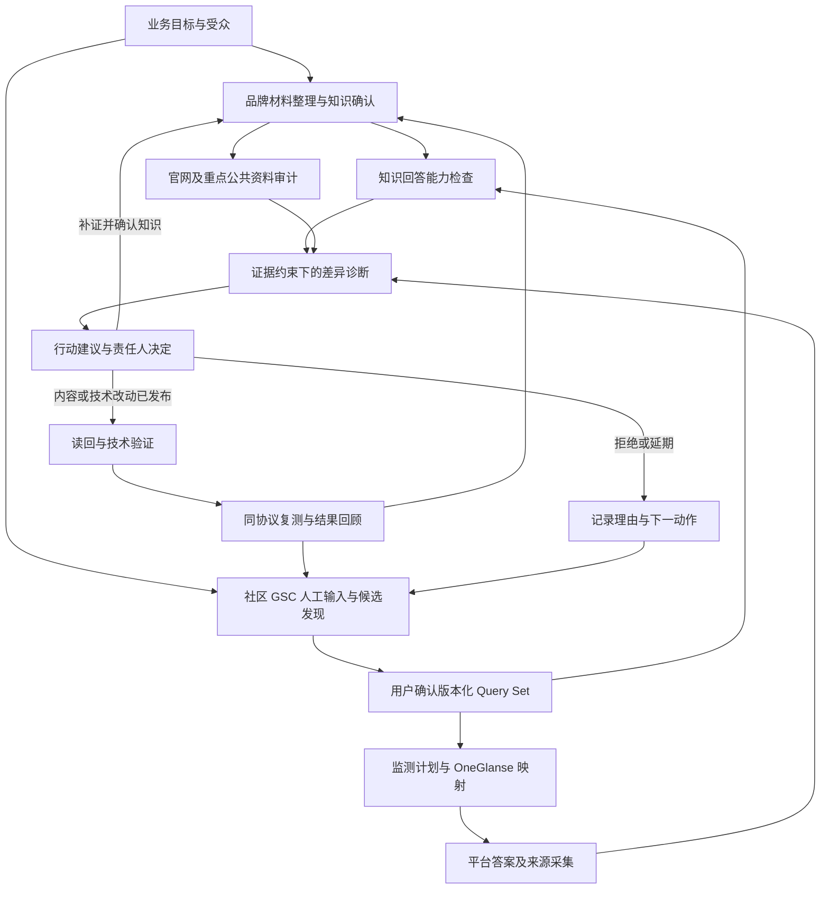

# GEO 用户旅程与持续循环：访谈草案

- 状态：proposed；Q1–Q51 核心业务选择已确认并收敛。创作者账号成功创建为注册完成，业务信号通过 GA4 自动读取；接入时创建飞书通知群，加入飞书智能体及对应人员。第 9 节列明实际资料、连接配置、实现与验收待办，不表示插件或正式业务已就绪。
- 创建：2026-10-18；更新：2026-10-21
- 来源：用户描述“提供品牌材料→整理到 MyyShop 工作区→社区/GSC/人工问题→确认 Query Set→OneGlanse 监测→知识、站点、公共资料和平台答案诊断”的旅程，要求结合行业做法逐步澄清。
- 关联：[既有领域术语](../../CONTEXT.md)、[信源监控与 Query 发现方案](../plans/2026-10-19-source-monitoring-and-query-discovery-plan.md)、[Query Portfolio PRD](../prd/2026-09-01-query-portfolio.md)、[知识独立就绪 PRD](../prd/2026-09-02-knowledge-independent-lifecycle-readiness.md)、[当前源码完整试跑](../records/2026-10-17-myyshop-geo-full-flow-audit.md)、[OneGlanse 计划](../plans/2026-10-17-oneglanse-mcp-integration-plan.md)。
- 范围：产品旅程、概念边界、可解释的输入/行为/产出、已有缺口与待决问题。仅文档整理和访谈，不改变已批准 Spec、业务暂停、采集实现或定时任务。

## 1. 本轮已知与未定

已由当前及此前用户表述明确：

- 用户从 Codex 等 Agent 提供品牌资料；业务知识与证据保存在 `workspaces/myyshop`。
- 资料可能包括定位、团队、发展历程、产品、评价和宣传文章。
- 问题可以来自社区、GSC、用户直接输入；希望持续发现网红成长和变现等主题中的需求。
- 用户确认 Query Set 后，经插件/MCP 使用 OneGlanse 保存问题、采集答案及其已有来源字段。
- cowork 负责品牌知识、Query 来源、GEO 判断、建议和人工决定；OneGlanse 负责 Server 授权、Tools 与原生采集服务。其采集与 MCP 都以 `/Users/sujingjun/dhnb/oneglanse` 为当前代码和运行边界。
- 希望检查知识回答能力、公开内容的技术基础与事实一致性、内容/证据缺口，以及品牌在答案中的表达。

第一轮已确认：非品牌成长/变现问题中的合适推荐为主目标，品牌定义/事实核验为基础分组；资料采用批次确认及增量复核；公开资料同时包含我方资产和第三方信源。

第二轮已确认：首期研究已在社媒发布内容、尚未通过内容获得金钱收入、正在寻找首次变现方式的创作者；监测采用美国/英语独立组；主要业务信号为创作者账号注册完成。研究人群与市场不等于产品准入或服务范围已核实，注册信号也不直接证明 GEO 的因果效果。

第三轮已确认：优先核验“找到并申请首次付费品牌合作”的承接路径；能力或资格未确认的问题仍可观察，但相关事实正误与推荐适配保持无法判断；插件先整理材料和可访问的官方资料，剩余补证由用户统一收口并最终批次确认。

第四轮已确认：保留全部原始材料，首批优先整理品牌身份与首次品牌合作相关规则；匹配主张、范围和时间的内部证据可用于内部事实对照，公开引用依据另记；材料差异先核对适用范围和已确认版本关系，再将未解决冲突交用户，其他工作继续。

第五轮已确认：首期接收文字资料并包含扫描件/图片识别，保留识别文字与原页对应关系供校对；部分读取失败不阻止可读取部分继续整理与确认，缺失和覆盖范围明确展示；知识更新后标出影响，后续新分析使用新知识版本，历史重评按需另行发起。

第六轮已确认：需求发现以公开创作者社区为主，GSC 和人工输入补充；模型生成的问题可作为标明生成依据的探索问题，经用户确认后纳入监测；首批同时覆盖创作者成长与首次变现，分主题报告。首次付费品牌合作仍为产品核验优先路径，需求研究范围更广，相关知识按缺口补齐，不将成长主题默认排除。

第七轮已确认：以用户已有 Query 监控和 Trust Watch 为基础，首批保留完整 13 类信源，并衔接舆情中的官网/官方资料及第三方评分/聚合来源；各源分别记录接入、覆盖与结果，不收窄为两个 Reddit 社区。地区未知的英文线索可以保留，补入的美国条件标为研究设定；原话整理为可独立理解的问句，同意图且关键条件相同才合并并保留来源。详细范围及历史状态见信源方案。

第八轮已确认：插件组织监控和接收原 ChatGPT 监控报告两种方式均支持，可组合使用并汇入同一套来源记录与去重流程；首次先导入可核验历史，再对缺失来源/窗口做最多 30 天回溯，之后增量。

第九轮已确认：插件侧每天北京时间 09:30 检查信源并接收新报告；每次保存完整报告，仅在有待确认的 Query 新增/变更、舆情事项新增证据或状态变化、需要用户处理的故障时汇总通知。无变化静默，同一事项没有新变化时不重复提醒。该频率不代替 OneGlanse 答案采样计划。

第十轮已确认：候选优先覆盖不同用户任务，同一任务内参考可核验来源与独立重复观察；首批规划容量最多 25 个问题（成长 10、首次变现 10、品牌基础核验 5）。20 个非品牌问题按固定 16、探索 4 规划，品牌组单列；实际问题与整数分组在审核包中确认，不凑数或自动更换。

第十一轮已确认：首批答案采样覆盖 ChatGPT、Gemini、Perplexity、Claude 和 Google AI Overviews；常规全量轮次每周一北京时间 10:00 开始，每题、每平台、每轮计划采样 2 次。满额 25 题为每周 250 个计划任务；两批安排见第十二轮，实际可用性与采样条件仍须验收，不能据此宣称获得 250 个独立有效样本。

第十二轮已确认：每个问题、每次采样从新会话或新搜索开始；同一周轮次分为周一北京时间 10:00、16:00 两批，满额各 125 个计划任务；先开展英文的美国场景研究，真实地区不可核验时保留 unknown 并与已核验美国环境的结果分开。新会话与地区条件仍需实际证据，现有 OneGlanse 的会话隔离缺口列为后续实现要求。

第十三轮已确认：仅对明确未提交且可精确限定范围的缺失任务，在下周轮次前最多安全补采一次；先报告已取得分项结果与缺口，只对满足同口径条件的固定组共同样本比较。Q37 最初选择 A，随后用户明确改为 B：每周 25 美元（USD），试跑与常规运行共用上限，按该预算安排执行；原“先测用量再决定金额”不再作为现行规则。

第十四轮已确认：正文中的品牌名称或已确认别名计品牌提及；推荐按语义判断，正文或结构化回答把品牌作为正向方案均可计入；主分母采用可完整读取、可评估的实质性回答。用户提供《GEO 生成式平台统计维度与 Chat 页面区域设计（V1）》全文作为统计参考，采用区域、信号和指标分开表达。参考稿中“适合推荐”分母与定位准确率单位的差异，已由第十五轮进一步确认。

第十五轮已确认：Q41=A，主推荐率采用当前分组内全部可评估实质性回答，产品适配另作解释；Q42=A，逐条主张核验正确、过期、错误、未知，优先展示具体差异与各类数量。用户明确采用共享品牌事实、答案卡复用：Agent 负责整理和关联，运营批次确认并处理异常，尽量减少重复维护。

第十六轮已确认：Q43=A，事实纠错优先；Q44=A，Agent 准备完整建议、改稿、补证清单或技术修复建议，运营协调现有负责人实际执行；Q45=A，由运营统一批次确认采用、修改、延期或拒绝并协调责任人。首期不纳入 Agent 直接操作站点/CMS 的执行范围，实际改动由负责人回传证明，Agent 接收并核验。

第十七轮已确认：Q46=A，发布核验和技术复查完成后复用随后完整的常规周采样；Q47=A，连续观察 4 周；Q48=A，到期报告实际变化和缺口，由运营批次决定收口或延长，不默认专项加跑或自动延长。原常规监测与本批改动观察分别管理，无改善和证据不足均如实呈现。

第十八轮已确认：Q49=A，创作者账号成功创建算注册完成，完善资料和申请合作另列；Q50=A，并明确通过 GA4 自动读取；Q51=B，人工异常通知同步到飞书。用户补充接入时创建群聊，拉入飞书智能体及对应人员，作为群内通知和协调入口；具体应用身份、成员及运行配置在接入阶段落实。

用户另行明确交付要求：插件就绪后整理可实际操作的本地手册，覆盖插件安装、关联服务启动，以及“补充资料、完善品牌知识库→生成 Query→跑采集”等完整使用流程。目录与完成判据见第 8 节。

核心业务选择已收敛，剩余工作是落实实际品牌知识、具体 Query、GA4 属性/注册事件/来源口径、飞书智能体及建群成员、OneGlanse 能力、运行预算和宿主配置。单项故障局部处理、未知提交不重发、安全补采限制、预算上限和静默通知原则沿用已有决定。Agent 优先从现有资料、代码和配置查证，只有无法核实且会改变行为的关键缺口集中补问；具体清单见第 9 节，不继续为常规配置逐项设置选择题。

以下旅程为讨论模型。访谈后将已确认内容写回既有术语和相应 canonical 产品文档；不会提前把草案升级为批准，也不为本轮再建一套运行引擎。

## 2. 先区分五个对象

| 对象 | 本轮建议定义 | 不能自动代表 |
| --- | --- | --- |
| 品牌原始材料 | 用户提供的文档、文章、介绍、案例、评价等原件，保留版本与来源 | 已核实事实、对外发布授权 |
| 可用品牌知识 | 有责任人、适用范围、时间和证据状态的品牌表述；规划和愿景单独标明 | 外部 AI 已经知道、所有能力已经上线 |
| 需求观察 | 在一个可追溯来源中观察到的用户表达或搜索信号 | 全市场需求量、发帖者身份已核验、平台原始提问全集 |
| 监测问题 Query | 要实际发送给答案引擎的完整文字，明确语言、受众、意图和来源 | GSC 原词、社区原话、AI 检索短语彼此完全等价 |
| 公开资产与外部信源 | 前者是可控制/可修订的官网、帮助、官方 PR 等；后者是第三方报道、评价、讨论及实际引用页 | 所有页面都可修改、域名看起来权威就足以支持事实 |

“可用品牌知识”至少要让读者区分：当前确认的品牌口径、仍待证实的主张、历史事实、未来规划、用户观点。确认方式已选定为批次确认、后续只复核增量；插件先整理可取得材料，用户统一补证并作最终批次确认。首批按当前目标整理；证据按其实际支撑的主张、范围和时间使用；冲突先核对适用范围与已确认版本关系。首期包含扫描件/图片识别，部分读取失败单列，知识更新标明影响而不自动重评历史；具体实现仍须验收。

私有工作区的知识用于内部判断和准备公开内容。消费者平台不会因为本地保存了文件就自动读取这些文件；对外结果的变化，需要经过可访问的公开资料或明确的外部检索/分发渠道。

## 3. 行业依据及其适用边界

1. Google 明确 AI Overviews/AI Mode 仍依赖 SEO 基础、可索引和可展示摘要的页面；不要求额外 AI 专用文件或特殊 schema，也不保证满足要求就一定出现。产品应检查技术可访问性、清楚的文本和事实支持，不能把“加了一个文件”当 GEO 成功。[Google AI features](https://developers.google.com/search/docs/appearance/ai-features)
2. GSC 提供站点相关的 Google Search 数据，API 不保证返回全部行。它适合发现已有搜索线索；把关键词改写为对话问题时，应保留原词和改写关系，不能宣称改写文本就是用户在 AI 中问过的话。[Search Analytics API](https://developers.google.com/webmaster-tools/v1/searchanalytics/query)
3. Bing 在 AI Performance 中按主题组织检索短语和机会，并明确部分主题/数量是模型分类或近似信号。这支持“主题→意图→问题组合”的组织方式，但 grounding query 是引擎检索短语，不是完整的消费者提问记录，也不是本插件现有数据接入。[Topics Portfolio](https://blogs.bing.com/webmaster/2026/10/introducing-topics-portfolio-beta-in-ai-performance/)
4. Profound 的官方说明展示了固定 prompts、主题组织、持续采样，并分别看 Visibility、FactCheck、Citations 等维度。这是一种具体产品做法，不是统一行业标准；它的 Visibility 分母有自身定义，不能直接与我们的“所有有效回答中的提及率”混用。[产品概念](https://help.tryprofound.com/articles/3443229936-answer-engine-insights-overview)、[分析维度](https://help.tryprofound.com/articles/5194011335-interpret-answer-engine-insights-v2?lang=en)
5. OpenAI 区分搜索发现和模型训练相关爬虫。公开资料能否被搜索访问，应按相应机制检查；允许某个爬虫不代表一定获得推荐。[Publisher FAQ](https://help.openai.com/en/articles/12627856)

6. canonical 是规范 URL 的选择信号；没有显式设置时，Google 仍会选择它认为合适的版本。因此，昨日检测器的 canonical/crawlability fail 只能按检测器规则解释，不能直接推断无法抓取或索引。技术审计需要区分真实阻断、改进建议和未知。[Google canonical 指南](https://developers.google.com/search/docs/crawling-indexing/consolidate-duplicate-urls)

7. 2026-10-19 选源核验：NewTubers 的社区说明聚焦小型创作者的学习、反馈和成长；UGCcreators 页面含新人、作品集、合作、报价等讨论分类。两者可提供候选来源线索，不证明发帖者都在美国、尚未变现或代表整体市场。用户随后指定沿用旧监控的完整信源清单，因此这两个社区不再作为首批覆盖上限。[NewTubers](https://www.reddit.com/r/NewTubers/)、[UGCcreators](https://www.reddit.com/r/UGCcreators/)
8. Reddit 官方说明，商业产品或服务使用其数据需获得许可并签订合同；公开浏览与产品持续数据接入不能混同。YouTube 官方提供评论线程读取接口，但存在评论关闭和权限不足等结果；API 存在不等于本插件已获得接入和数据覆盖。选源与接入就绪分别记录，本轮不发起申请、付费或持续采集。[Reddit 数据使用说明](https://support.reddithelp.com/hc/en-us/articles/14945211791892-Developer-Platform-Accessing-Reddit-Data)、[YouTube commentThreads.list](https://developers.google.com/youtube/data/reference/rest/v3/commentThreads/list)

本草案结合上述来源形成产品流程；分组、采样量、预算和流程规则以第 7 节用户已确认选择为准，不宣称来自统一 GEO 标准。实际实现与验收按后续规格和真实证据判断。

## 4. 用户旅程草案

### J0 明确目标和服务范围

- 输入：品牌、目标创作者、地区/语言、当前可提供的产品和希望改善的结果。
- 行为：将“纠正品牌认知”“在非品牌需求中被合适地推荐”“观察风险/趋势”分开，选择当前主目标。
- 产出：一张目标卡，写清谁在什么问题下应如何理解/使用 MyyShop，以及哪些问题不应强行出现品牌。
- 完成条件：有可解释的主要成功标准；未确定受众/目标时不替用户批量编造问题。
- 已确认：非品牌需求中的合适推荐为主目标；品牌定义核验作为基础分组。首期聚焦已发布内容但尚无内容金钱收入的创作者，采用美国/英语监测组，以创作者账号注册完成为主要业务信号，优先核验首次付费品牌合作路径。实际服务能力、资格及事件口径仍待核实。`what is myyshop` 测的是品牌定义，不足以代表网红成长/变现主题的获客表现。
- Q18=B 已确认：需求研究同时覆盖创作者成长与首次变现并分主题报告；产品核验仍按 Q7 优先首次品牌合作。成长类问题可进入首批，不要求都与品牌合作直接关联；是否适合推荐 MyyShop 另按真实能力与问题意图判断。

### J1 输入材料并建立工作区知识视图

- 用户：提供文件/链接，并说明哪些是当前资料、历史资料、规划或用户评价。
- 插件：保存原件与来源，提取主题、具体主张、时间、地区/资格条件，发现相互冲突或缺少依据的内容。解析失败应报告具体文件，不能当空文档。
- 已确认责任：插件先整理已有材料和可访问的官方资料；缺失规则与证据由用户统一汇总产品/运营答复。Q41–Q42 进一步明确 Agent 整理共享事实、维护答案卡和 Query 关联，运营按指定人工确认身份批次确认并处理异常，不重复逐题填写相同事实。
- 已确认范围：保留全部原件与来源，首批优先结构化品牌身份和首次品牌合作相关的产品、资格、地区、申请、费用/付款规则；其他主题登记为待整理，后续按需展开。未整理不能被解释为没有事实、产品不支持或存在内容缺口。
- 已确认冲突处理：先核对地区、人群、生效时间与明确的替代关系；按已确认版本关系整理，新材料仍进入批次确认；无法解释的同范围冲突交用户判定，仅将相关事实的正误/适配保留为无法判断。
- 已确认输入：Markdown/TXT、DOCX、可提取文字的 PDF、公开网页正文、明确作为知识补充的聊天文字，以及扫描件/图片识别。保留识别文本和原页对应关系供校对；识别结果继续按草案处理，不因识别完成就确认事实。
- 已确认部分失败处理：可读取且可追溯的部分继续整理与批次确认；失败、缺页或不完整部分单列并展示覆盖范围；依赖缺失内容的判断仍为待确认，不推断原文没有限制条件。
- 产出：资料目录、结构化知识草案、冲突/待证清单、需要用户确认的摘要。
- 完成条件：用户看得见原文到知识条目的对应关系；未经确认的承诺和规划不会悄悄变成已上线能力。
- 当前能力：有 Document/Claim/Evidence/Answer Card/Release 对象和草案构建基础；真实品牌任意材料导入、批次审核与变更体验仍需补齐，不能用临时演练导入代替正式产品入口。

### J2 持续收集需求线索

- 输入：已确认目标、允许访问的社区/第一方资料/GSC，及用户直接提供的问题。
- 已确认发现顺序：优先公开创作者社区问题与讨论，GSC 和用户直接提供的问题补充；发现顺序不自动决定每条 Query 的业务优先级。
- 已确认覆盖：沿用历史监控的 Reddit、Apple App Store、Google Play、Trustpilot、PAA、TikTok、Instagram、YouTube、LinkedIn、Facebook、新闻媒体、普通博客、Discord；衔接官方资料及第三方评分/聚合页。需求、舆情和公开一致性分开产出；来源用途与暂不可用情况见信源方案。
- 已确认入口：插件在当前宿主组织监控、导入原 ChatGPT 监控报告均支持，统一记录原始来源和取得路径并跨入口去重。首次导入可核验历史，再对缺失来源/窗口最多回溯 30 天；原报告摘要与底层原文核验状态分别呈现。
- 已确认节奏：插件侧每天北京时间 09:30 检查信源并接收报告；保存完整结果，只对待确认的 Query 变化、舆情证据/状态变化或需用户处理的故障汇总通知。上游实际未产出报告时如实记录，不编造新增；这是信源节奏，不自动启动同频率的消费者答案采样。
- 插件：保存观察原文或必要摘录、来源、时间、地区/语言（未知就标未知）；识别重复、广告和无关线索；将同一用户问题的不同说法关联起来。
- 产出：带来源的需求观察和候选主题，例如成长、合作机会、收益规则、产品选择等；这里的例子不代表已发现真实需求。
- 已确认生成问题用途：没有观察原话的问题可作为标明生成依据、缺少需求观察的探索候选，经用户确认后纳入 Query Set；后续补到真实来源仍保留原生成记录。
- Q20 已确认：地区未知线索可以保留并与原文自述/标注美国的来源区分；若为美国组补入条件，标为研究设定，不回写为原帖事实。
- 边界：社区里“有人问过”不等于需求规模；GSC 曝光不是 AI 提问量；模型建议的问题要标为生成候选。
- 当前能力：已有人工、GSC、知识生成与候选整理入口。面向哪些社区持续采集、如何取得允许访问的数据、如何去噪与判断新趋势，尚需明确并接入。

### J3 形成并确认 Query Set

- 插件：按主题、意图、受众和语言整理候选，展示来源、选择理由、品牌关联度和被排除项；保留原话/原词与最终发送文字的关系。
- 用户：确认本轮关心的问题及排除范围，不需要手工拼 ID/hash。
- 产出：版本化问题集合。品牌基础核验与非品牌需求分开，固定组与探索组分别报告。
- 已确认首批主题：成长与首次变现同时覆盖，分主题报告；模型生成的探索问题允许进入确认流程，不能记为社区原话或真实需求频次。
- Q21 已确认：保留原文，另生成去身份化、可独立理解的问句；同意图且关键条件相同才合并并保留全部来源，影响答案的条件不同则分开；非品牌组不自行插入 MyyShop。
- Q26–Q28 已确认：优先覆盖不同用户任务；首批最多 25 个不同问题，成长 10、首次变现 10、品牌基础核验 5；非品牌容量按 80% 固定、20% 探索规划，即满额时 16+4，品牌组单列。候选不足时展示实际数量和覆盖缺口，具体问句和分组仍须用户确认。
- 完成条件：实际发送文本、包含范围和版本可复现。新增问题进入候选/下一版本，不静默改变旧周期的分母。
- 待落实：实际问句、来源与任务覆盖的审核包；组更新/淘汰或容量调整按已确认的人工确认与版本规则处理，不静默更换。既有源码的固定来源优先级不能直接代替 Q26 已确认的任务覆盖优先原则，相关实现与合同调整在后续落地。

### J4 制定监测计划并对接 OneGlanse

- 用户确认：平台、语言/地区、频率、重复次数、预算、有效期与故障通知范围。
- 已确认目标：五个平台（ChatGPT、Gemini、Perplexity、Claude、Google AI Overviews），每周一北京时间 10:00、16:00 分两批，每题/平台各采样一次；满额两批合计 250 个计划任务。每题/每次要求新会话或新搜索；英文美国场景与实际地区证据分别记录，地区未知结果单列。
- cowork：保存 Query 版本到原生 prompt ID 的映射，读取 OneGlanse 实际能力和运行范围，并核对与本轮授权一致。
- OneGlanse：维护原生 prompts、采集服务与可提供的状态/结果；cowork 不操作其浏览器、队列或数据库。
- 产出：可执行监测计划与已验证映射；不是仅写一个“每天运行”的文档。
- 失败恢复：未知提交先查原任务，不自动再次启动；解析/分析失败复用已保存答案。睡眠、离线、凭据失效和漏跑要显示为未采集。
- 已确认补采与预算：明确未提交且授权/范围仍有效的缺失任务，在下周轮次前最多安全补采一次；接口不能精确执行缺失范围时不全量重跑。试跑、常规采样及相关运行费用共享每周 25 USD 上限，计费操作须先核验用量/计价并预留费用，不能以凑满计划量为由超限。
- 当前缺口：现有 cowork helper 明确只验证 `single-query-engineering`；完整 Query Set、原生选择配置与定时计划的 MCP 接续没有完成端到端验收。调度归属、设备在线条件和授权生命周期待设计，不新建重复任务引擎。

### J5 三条检查并行进行

| 分支 | 要回答的明确问题 | 产出 | 缺数据时怎么办 |
| --- | --- | --- | --- |
| A 知识回答能力 | 对这个问题，我们能基于现行知识回答哪些内容？每项可核实主张的证据和适用边界是什么？ | 可回答部分、答案草案、逐项证据/知识缺口 | 缺内部知识只报告输入缺口，不据此断言外部内容有缺口；不补造答案 |
| B 公开内容和技术基础 | 官网/帮助/PR 等是否可访问、可被理解，是否包含关键答案，和现行表述是否一致？ | 页面快照、技术问题、表述差异、过期或不完整内容 | 无权限/抓不到不是页面没有内容；历史报道按发表日期解释，不强制改成当前版本 |
| C 外部答案观察 | 在约定条件下，平台实际给出什么答案、提到哪些品牌、回传哪些来源？ | 不可变原始回答、来源列表、时间和可观测条件、采集质量状态 | timeout/error 不计成未提及；sources 空但提取覆盖未知时不能计成确定无引用 |

建议网站基础检查不必等第一批答案。Q8 已确认：能力或资格未确认的问题可以继续观察平台回答和品牌提及，相关事实正误与推荐适配保留为无法判断，不能仅因未推荐就认定内容缺口。已具备证据的其他事实可分别判断。该产品行为尚未接入现有正式 Cycle；正式启动规则与新观察入口的接续仍需后续设计和实现，不在访谈时直接解除现有门禁。

### J6 汇总诊断：分别对照知识、公开内容和平台回答

1. 知识对照需求：是否有能力和证据回答用户关心的问题？
2. 公开内容对照知识：确认的事实是否已公开，是否过期或互相矛盾？
3. 平台回答对照知识：表达是正确、遗漏、过期、无依据新增，还是证据不足无法判断？
4. 来源对照回答：能否确认链接支撑了对应说法，来源是原文、转载、观点还是官方说明？引用摘录不替代页面原文。

Q11 已确认：适用的内部证据可用于内部事实对照。现行规则材料需明确适用范围，成效数字需有对应记录、统计口径和时间范围；宣传文章或个例不自动支持普遍效果。内部判断依据、公开可引用依据和发布权限分别记录，不能因存在内部证据就认定已经有公开页面支持。

建议输出问题分类：输入/知识待补、证据缺口、内容缺口、技术问题、公共资料不一致、产品能力待确认。用户存在需求且产品确实不支持，才进入产品判断；不能让 AI 用一篇软文补成不存在的产品能力。

当前缺口：OneGlanse intake 尚未进入正式 Sample/Source/Review/Cycle；本次试跑的真实语义分析由 Agent 显式组装输入完成。正式 M4 入口仍要求已审核 Baseline。新流程需在既有 Skill/工具中补接续及能力声明，不能伪造 formal 字段。

### J7 看指标，同时看数据质量

Q38–Q42 已确认正文提及、语义推荐、实质性回答分母及逐条主张核验；主推荐率不按产品适配筛选。完整区域映射与参考稿采用边界见第 7 节第十四、十五轮。

Q36 已确认：先出分平台、分主题观察及完整缺口；变化比较仅使用固定组中满足同口径条件的共同有效样本，条件未知或延后补采单列。没有共同可比集合时输出不可比较，不能把缺失平台或技术失败补成零。

| 指标 | 表达与当前决定 | 不代表 |
| --- | --- | --- |
| 样本覆盖 | 实际获得可观察结果 / 计划采样任务，同时列出超时、拒答、挑战等状态 | 低覆盖时仍有可靠完整市场结论 |
| 品牌提及 | Q38=A：正文含品牌名或已确认别名的可评估实质性回答数 / 正文可评估的实质性回答数；同一回答最多计一次 | 推荐、正面评价或市场占有率 |
| 明确推荐 | Q39 自定义：按语义判断正文或结构化回答是否把品牌作为正向方案；Q40=A、Q41=A 使用当前分组全部可评估实质性回答，产品适配另作解释 | 出现品牌卡片就一定推荐、平台推荐就证明产品实际适配 |
| 引用表现 | 明确引用关系、来源区曝光和已保存来源列表分别显示；官网与第三方品牌报道分开；各指标同时显示区域覆盖 | sources=[] 一定无引用、来源卡片一定参与生成或支持原说法 |
| 核心事实表达 | Q42=A：逐条主张对照共享现行知识，报告正确、过期、错误、未知及具体依据；未表述单列，相同事实复用 | 缺少表述等于事实错误、无证据等于正确或不支持 |
| 业务信号 | Q49=A：创作者账号成功创建；Q50=A：GA4 自动读取。完善资料、申请合作与可识别 AI 引荐另列；实际注册事件、创作者身份、事件次数/去重账号口径分别核验 | 提及率上涨直接造成注册或收入增长；事件次数等于新增账号；注册就代表已获得合作或收入 |

品牌词与非品牌词分别看，成长与首次变现按 Q18 分主题报告，固定/探索、平台/语言/地区/时间窗分别看。Q40=A 已排除纯拒答、确认无 AI 答案及技术缺失；错误、负面或产品不适配的实质回答不能因此被剔除。各指标展示实际分子/分母、可评估范围和未知项，分母为 0 时不可计算。品牌词典明细、实际位置提取与覆盖仍需落实，不展示统一 GEO 综合分数。

### J8 形成可执行行动，由责任人采用

- 证据缺口：插件先整理已有材料与可访问的官方资料，再明确仍缺哪一份政策、产品说明、数据或案例及完成判据；首期由用户统一收集产品/运营补证材料。
- 内容缺口：已有事实和证据未被合适的页面覆盖时，生成具体 FAQ/文档/案例/页面修改建议。
- 技术问题：生成具体页面和失败条件；由站点责任人修复。
- 公开信息冲突：区分我方可改的资料、需要联系的第三方、应保留时间语境的历史报道。
- 产品问题：交产品负责人判断，不自动承诺新功能。

Q43–Q45 已确认：事实纠错优先，严重资格、费用和结果承诺误导优先呈现；其余按需求相关性、证据及可执行性安排。Agent 准备有具体依据、目标和完成判据的完整建议及改稿，运营统一批次确认采用、修改、延期或拒绝，协调站点/内容负责人实际执行并回传结果。排序不阻止其他独立事项推进；未证实差异先补证。

首期复用现有发布流程，不纳入 Agent 直接修改站点/CMS。Agent 接收实际改动/发布证明并读回核验，草稿、采用、执行和发布状态分别记录。运营批次确认行动不替代真实发布证明；对第三方的更正请求可以准备草稿，实际联系和发送仍需具体授权。

### J9 验证实际改动，再复测

- 收到负责人提供的真实改动/发布回执后，按已授权范围读回目标页面，核对采用项、版本和实际内容；记录技术复查结果及失败/不可验证项。
- 用同一固定 Query Set 和可比的采样条件复测；另列探索组，不把换问题造成的差异当提升。
- Q46–Q48 已确认：页面改动核验及技术复查完成后，AI 复测复用随后完整的常规周一两批；按真实时间连续观察 4 周，到期由运营批次决定收口或延长，不默认加跑或自动延长。观察不承诺指定时间内改善，不因结果没变就自动重复提交。
- 产出：改动证据、复测结果、未完成/失败项与剩余限制。未发布只算建议准备；无改善也可以结束本轮观察并形成下一决定，不无限等待正向结果。

### J10 回顾并更新下一轮

- 分别判断：技术修复是否完成、品牌表达是否改善、引用/推荐是否变化、业务信号怎样变化。
- 接受/拒绝/延期后续行动，更新知识的新版本和候选问题；旧样本、旧 Query Set 和旧发布证明保留原始语义。
- Q15 已确认：知识更新后标出受影响事实、Query 与结论；后续新分析使用新知识版本，已冻结输入和原报告保留。历史答案重评按需另行发起，复评标明知识版本与生效范围，不冒充平台的新回答。
- 持续监控产出观察；一次改进轮次针对一批具体改动观察 4 周并由运营回顾。该批次收口不自动停止已启用的常规监测，也不恢复既有暂停任务；延长或新的改进目标由运营决定并保留范围与版本。
- 当前代码的“两周期验收”是既有实现/验收范围，不自动构成产品应永远只运行两轮的定义。

## 5. 一张关系图

图示表达已确认的核心业务关系，不表示所有节点已实现。图文语义和连接已检查，尚未执行渲染验收。

## 6. 用户操作示例（仅演示逻辑）

以“粉丝不多，怎样获得付费品牌合作？”为例，这是说明流程用的候选问题，不声称本轮已在社区发现该原话。

- 知识里只有“支持所有阶段创作者”，不足以自动承诺零粉丝、任何地区都能收到商单；需要资格、地区和产品规则。
- 如果能力确实存在且证据充分，但官网没有解释申请方法，才形成相应内容缺口。
- 如果尚无能力/资格证明，先补证；如果产品并不支持，交产品负责人判断，不写成已经支持。
- 如果 AI 只推荐别家，先看问题是否与 MyyShop 适配、我方公开材料与引用来源，再形成解释；不能直接归因为某个 SEO 技术项。
- 修改并公开后再复测，观察“是否被合适地推荐”和“描述是否准确”，不能只看出现了几次品牌名。

## 7. 访谈决策队列

每轮解决当前独立且必要的决定。回答后记录选择、理由、影响和仍未解决的边界；只有真实达成一致的术语才更新 `CONTEXT.md`。重大难逆架构选择再使用既有 ADR 体系，不把未确认建议写成 ADR 决定。

### 第一轮：已确认

确认来源：用户明确回复“按你的建议继续下一轮采访，逐步把每个环节、判断规则和职责边界确认清楚。”本次按上一轮三个明确推荐记录为 Q1=B、Q2=A、Q3=A；不将其他尚未提问的草案内容一并视为确认。

| 决定 | 已确认内容 | 保留的边界 |
| --- | --- | --- |
| Q1=B | 以创作者成长、变现的非品牌需求中的合适推荐为主目标；品牌定义/事实核验为基础分组 | 首期人群、市场与主要业务信号已在第二轮确认；提到品牌不等于合适推荐 |
| Q2=A | 插件整理后由用户按批次确认现行口径；证据不足、冲突、规划单列；后续复核增量 | 确认内部口径不等于证据充分，也不等于批准外部发布；本次没有批准任何具体知识内容 |
| Q3=A | 覆盖我方公开资料，以及第三方报道、评价和社区讨论；分别管理 | 能读取、能支持事实和有权修改分别判断；源清单、访问方式及处置权限待定 |

### 第二轮：目标用户、市场与业务结果（已确认）

确认来源：用户于 2026-10-19 明确回复“4A、5A、6B”。这三项限定首期监测的研究对象和预期用户动作，不自动批准具体品牌事实或实际监测执行。

| 决定 | 已确认内容 | 保留的边界 |
| --- | --- | --- |
| Q4=A | 已在社媒发布内容、尚未通过内容获得金钱收入、正在寻找首次变现方式的创作者 | 这是研究人群，不是注册资格或粉丝门槛；尚未证明 MyyShop 对该人群的具体服务可用 |
| Q5=A | 美国/英语作为首个独立监测组 | 不反推产品在美国的注册、参与机会或收款资格；采集条件能否代表该市场须在监测协议中核实 |
| Q6=B | 创作者账号注册完成作为主要业务信号；AI 引荐访问与后续申请分别作为前后环节观察 | 注册完成事件、去重、来源识别和归因另行确认；访问、注册、申请、获得收入不能相互替代 |

选择理由：先固定一个创作者阶段与市场，保持后续问题和结果可比较；用注册观察从答案发现到进入产品的行为。研究范围的选择不替代产品适配核验或业务结果测量。

### 第三轮：产品承接、能力未知与补证责任（已确认）

确认来源：用户于 2026-10-19 明确回复“7A、8A、9A”。

核验依据：[Brand Deals](../../workspaces/myyshop/knowledge/05-products-services/brand-deals.md)、[MyyFinds](../../workspaces/myyshop/knowledge/05-products-services/myyfinds.md)、[Free Value Report](../../workspaces/myyshop/knowledge/05-products-services/free-value-report.md)、[达人加入资格](../../workspaces/myyshop/knowledge/04-audience-lifecycle/creator-eligibility.md)及[支持地区](../../workspaces/myyshop/knowledge/06-commercial-rules/supported-regions.md)均为 `draft`。其中产品状态、资格、地区或交易规则仍有待确认项；模板中的“批准表述”标题本身不构成批准。

| 决定 | 已确认内容 | 保留的边界 |
| --- | --- | --- |
| Q7=A | 优先核验找到并申请首次付费品牌合作的承接路径，Brand Deals 为候选产品线索 | 选择核验方向不证明产品已上线或目标人群具备资格；若不适配，记录原因并重新选择；主要业务信号仍为注册完成 |
| Q8=A | 能力或资格未知的问题继续保留为观察问题，记录平台回答和品牌提及；相关事实正误、推荐适配保留为无法判断 | 不能仅因未推荐就判定内容缺口；观察和可评价范围分别标明；本次没有解除正式 Cycle 门禁或启动实际采集 |
| Q9=A | 插件先整理现有材料和可访问的官方资料，用户作为首期单一补证联系人，汇总产品/运营答复并最终批次确认 | 未授权 Agent 对外发送消息，也未批准任何具体产品事实或缺证主张 |

选择理由：围绕一条具体变现路径核验产品；知识未齐时继续观察外部答案；补证保持明确联系人。后续仍须定义何种证据支持何种判断，以及冲突如何处理。

### 第四轮：首批知识范围、证据支持与冲突处理（已确认）

确认来源：用户于 2026-10-19 明确回复“10A、11A、12A”。

| 决定 | 已确认内容 | 保留的边界 |
| --- | --- | --- |
| Q10=A | 全部原件与来源保留，首批优先结构化品牌身份和首次品牌合作相关规则；其他主题登记为待整理 | 未整理不等于不存在、不支持或内容缺口；事实、历史、规划、观点及原文关系仍须保留 |
| Q11=A | 适用内部证据可支持内部事实对照；规则用已确认现行且范围明确的材料，成效数字用对应记录、口径与时间范围；内部与公开引用依据分别记录 | 宣传文或个例不自动证明普遍效果；本次未批准任何具体材料，内部判断依据也不等于对外披露权限 |
| Q12=A | 先核对地区、人群、生效时间和已确认替代关系；无法解释的同范围冲突交用户判定，其他工作继续 | 新材料仍需批次确认；保留原文和历史；文件修改时间不能单独决定有效性；受影响事实暂不作正误/适配结论 |

现有[证据模板](../../workspaces/myyshop/knowledge/01-templates/evidence-record-template.md)区分公开 URL、内部位置、适用范围和数据口径；[Spec 0004](../specs/0004-knowledge-query-operating-system.md)第 5 节及 `knowledge-query.mjs` 已有按主张类型给出充分性建议的规则。现有规则允许 Owner 在保留缺证 warning 和限制的前提下纳入内部 Knowledge Release；纳入知识包与证据充分并不等价。本轮确认的是产品行为，没有修改 validator 或将素材提升为已批准知识。

### 第五轮：输入格式、部分失败与知识更新（已确认）

确认来源：用户于 2026-10-19 明确回复“13b、14A、15A”，按选项记录为 Q13=B、Q14=A、Q15=A。

| 决定 | 已确认内容 | 保留的边界 |
| --- | --- | --- |
| Q13=B | 在 Markdown/TXT、DOCX、文字型 PDF、公开网页正文和明确知识补充的聊天文字之外，首期同时支持扫描件/图片识别，保留识别文本与原页对应关系供校对 | 日常操作指令不当作品牌事实；识别结果仍需核对与批次确认；音视频不在本题范围，复杂表格或页面读取不完整须报告 |
| Q14=A | 成功读取且可追溯的部分继续整理和批次确认；失败或缺页项单列，展示本批覆盖范围 | 依赖缺失内容的事实保持待确认；未读到不等于原文没有；不能将部分成功写成整批完成 |
| Q15=A | 新知识确认后标出受影响事实、Query 和结论；后续新分析使用新知识版本，历史重评按需另行发起 | 原始回答、原报告及已冻结评估输入保留；复评使用的知识版本与生效范围明确，不算新的平台采样 |

现有专用读取器 [knowledge-markdown.mjs](../../plugins/geo-expert/scripts/lib/knowledge-markdown.mjs)只读取指定分类目录内的 Markdown；其 `knowledge-workspace.mjs` 调用仍属于隔离演练入口。用户选择 Q13=B 后，扫描件/图片识别属于首期要求，不能继续列为默认人工转换或后续可选项。实现优先使用宿主现有读取能力和既有工具；多格式真实品牌入口及目标宿主仍须实际验收，不由访谈确认推断已经具备该能力。

### 第六轮：需求来源、生成问题与首批主题（已确认）

确认来源：用户于 2026-10-19 明确回复“16A、17A、18B”。

| 决定 | 已确认内容 | 保留的边界 |
| --- | --- | --- |
| Q16=A | 首批需求发现以公开创作者社区的问题与讨论为主，GSC 和人工输入补充 | 发现顺序不自动决定每条 Query 的排名；具体社区及访问方式待定；英文不等于美国来源 |
| Q17=A | 模型生成问题可作为明确标记的探索问题，经用户确认后进入 Query Set，保留生成依据和缺少需求观察的状态 | 不冒充用户原话、搜索量或需求频次；后续新增观察来源不抹去生成记录 |
| Q18=B | 首批同时覆盖创作者成长与首次变现，分主题报告 | 首次品牌合作仍为产品核验优先路径；成长问题不因缺少直接品牌合作关系就排除，未知能力继续按 Q8 保留观察；数量与采纳规则待定 |

已有 [query-inputs.mjs](../../plugins/geo-expert/scripts/lib/query-inputs.mjs)保留人工/GSC/知识生成输入来源；[Query Portfolio](../specs/0011-query-portfolio.md)及当前实现另有 `community_expression` 等类别和固定来源优先级建议。类别或建议值存在不证明社区持续发现已经接通，也不证明某来源的问题一定更有业务价值。本轮未修改既有优先级实现或创建正式 Query。

### 第七轮：广覆盖信源、地区未知与 Query 整理（已确认）

确认来源：用户提供[创建监测任务](https://chatgpt.com/c/6a9ad78f-f618-83ea-bb53-96a27ee764ab)、[MyyShop Trust Watch](https://chatgpt.com/c/6a91b7bb-a52c-83ea-b348-5d4ee81fe694)及 13 类来源表，要求“可以在这个基础上完善监控和 query 发现，首批信源覆盖要全一些”，并明确回复“20 a”“21 a”。Q19 因此采用用户自定义的扩展范围，不记录为上一轮 19A 或 19B。

| 决定 | 已确认内容 | 保留的边界 |
| --- | --- | --- |
| Q19=用户指定扩展 | 在原有 Query 监控和舆情基础上完善首批覆盖，保留 13 类来源及其状态，并衔接公开事实/评分变化监控 | 候选覆盖、实体确认、持续访问和本次新增分别判断；未接通来源报告具体缺口，不消失也不伪装为无需求 |
| Q20=A | 地区未知的英文线索可以纳入，和原帖明确自述/标注美国的来源区分；补入的美国条件标为研究设定 | 不按语言猜测作者地区；收入阶段等未知属性也不推断；原帖内容不被研究设定覆盖 |
| Q21=A | 保留原文，另生成去身份化、可独立理解的 Query；同意图且关键条件相同才合并并保留全部来源 | 平台、阶段、地区等影响答案的条件不同要分开；非品牌组不加入 MyyShop；最终发送文本仍由用户确认 |

本轮已读取两段对话的近期报告；用户粘贴的 Reddit 9 条对应 2026-10-18 窗口，2026-10-19 的历史报告另记 13 条。历史报告与状态不等于本轮平台重测；原始任务配置全文、完整去重账本和当前调度状态未由近期报告确认。具体整合见[信源监控、舆情与 Query 发现方案](../plans/2026-10-19-source-monitoring-and-query-discovery-plan.md)。

### 第八轮：监控入口与历史回溯（已确认）

确认来源：用户于 2026-10-19 明确回复“22AB都支持、23A”。Q22 记录为 A+B，不强制二选一。

| 决定 | 已确认内容 | 保留的边界 |
| --- | --- | --- |
| Q22=A+B | 插件在当前宿主组织来源检查，及接收原 ChatGPT 监控报告，两种方式均支持；可组合使用，汇入品牌工作区统一处理 | 同一内容跨入口去重，保留取得关系；报告接收成功不等于底层原文已核验；不因此自动修改旧任务或新建通用调度引擎 |
| Q23=A | 先导入可核验历史，再对缺失来源/窗口做最多 30 天回溯，之后按各来源已完成检查窗口增量 | 回溯窗口执行前确定、恢复不漂移；已有内容复用，失败片段不当作已检查；30 天不限制既有历史保留期限 |

两种入口的对齐与去重说明已同步到[信源方案第 9 节](../plans/2026-10-19-source-monitoring-and-query-discovery-plan.md)。这是产品要求确认，不表示当前插件已具备完整监控入口或已开始历史回溯。

### 第九轮：信源检查频率与通知（已确认）

确认来源：用户于 2026-10-20 明确回复“24A、25A”。

| 决定 | 已确认内容 | 保留的边界 |
| --- | --- | --- |
| Q24=A | 插件侧每天北京时间 09:30（Asia/Shanghai）检查信源并接收新报告 | OneGlanse 答案采样频率另定；不自动修改上游 ChatGPT 时间；设备离线、漏跑和运行预算仍待配置，不倒填执行结果 |
| Q25=A | 每次保存完整报告；仅在待确认 Query 新增/变更、舆情新增证据/状态变化、需用户处理的故障时汇总通知 | 无变化静默，同一未解决事项无新变化不重复提醒；通知渠道与运行配置按实际宿主实现，此处未创建自动化或对外消息通道 |

### 第十轮：Query 筛选、首批容量与固定/探索组（已确认）

确认来源：用户于 2026-10-20 明确回复“26A、27A、28A”。本轮确定首批问题筛选原则及容量，不减少信源清单，也不把全部观察内容自动送给 OneGlanse。

| 决定 | 已确认内容 | 保留的边界 |
| --- | --- | --- |
| Q26=A | 在成长/首次变现主题内优先覆盖不同用户任务，同一任务内参考可核验来源与独立重复观察 | 热门话题不自动占满集合；低频新问题和生成假设仍可探索；不同来源覆盖的原始条数不当作市场频次 |
| Q27=A | 首批最多 25 个不同问题，按成长 10、首次变现 10、品牌基础核验 5 规划 | 容量不等于必须填满；候选不足展示缺口，不制造重复问法或虚构需求证据；品牌与非品牌分组报告 |
| Q28=A | 非品牌容量 80% 固定、20% 探索，满额时为 16+4；品牌基础核验组单列 | 分组用途与来源类型分别记录；实际整数分组和问句在审核包确认；任何增删保留版本，探索组不自动随新帖替换 |

上述是本次产品容量选择，不是行业统一标准。完整 Query Set 经 MCP 运行的接续仍须补齐和验收，选择容量不等于已批准具体问题或已授权实际采集。

### 第十一轮：答案平台、常规采样频率与次数（已确认）

确认来源：用户于 2026-10-20 明确回复“29b、30A、31A”，记录为 Q29=B、Q30=A、Q31=A。

| 决定 | 已确认内容 | 保留的边界 |
| --- | --- | --- |
| Q29=B | 首批目标覆盖 ChatGPT、Gemini、Perplexity、Claude 和 Google AI Overviews 五个平台 | 支持声明不等于登录、授权或运行就绪；某平台未就绪单列缺口，不算零提及、不拿其他平台替代；AI Overviews 不等于 AI Mode |
| Q30=A | 每周一北京时间 10:00（Asia/Shanghai）开始常规全量轮次 | 日常信源检查仍为每天 09:30；只用已确认且有效的 Query Set；首次基线/专项复测另按计划，未自动安排具体启用日期 |
| Q31=A | 每题、每平台、每轮计划 2 次，分开执行与记录 | 重复读取、原生重试不算额外样本；失败/条件未知如实记录，不无限补跑；2 次不自动证明独立性或正式 Baseline 成立 |

按满额 25 题，当前选定的常规周计划量为 `25 × 5 × 2 = 250` 个任务。这不是成功回答数、实际平台提交次数或费用承诺；原生重试和分析调用另计。

当前 OneGlanse 的平台枚举与 MCP 分别声明支持列表、授权和运行范围；已记录的当前仓库实测仍为单 Query/Gemini。五平台批量及重复采样需要后续验收，既有单题授权和验证不能由本轮选择自动扩大。

### 第十二轮：会话、两次执行时间与美国场景（已确认）

确认来源：用户于 2026-10-20 明确回复“32A、33B、34A”。

| 决定 | 已确认内容 | 保留的边界 |
| --- | --- | --- |
| Q32=A | 每个问题、每次采样从新会话或新搜索开始，隔离本轮前一题的上下文 | 属于 OneGlanse 待补齐/验收要求；新会话不等于关闭长期记忆或个性化，实际模式和可观测条件仍记录，不伪造独立性证明 |
| Q33=B | 同一周轮次在周一北京时间 10:00、16:00 分两批开始；满额每批 125、合计 250 个计划任务 | 这是批次目标开始时刻，逐题实际提交时间另记；前批未结束不重叠提交，延后/漏跑如实报告；不是改为周一、周二各一批 |
| Q34=A | 英文美国场景研究；涉及地区规则时明确美国，记录实际账号/页面/环境条件，地区无法确认标 unknown，与已核验美国环境分开 | 不能把问题中的美国、英文或便利样本当作已验证美国地区实测或用户总体代表性；条件未知也不自动变成跨期可比 |

源码核验发现的题间隔离差异仍为当前状态：Gemini 配置明确复用会话，ChatGPT/Claude 无题间重置 hook；Perplexity/AI Overviews 有重置，但也不能只凭重置推断个性化或地区一致；MCP 会话独立性仍声明 unknown。Q32=A 将逐题新会话明确为后续要求，由 OneGlanse 维护其实现和可核验证据，cowork 经 MCP 使用能力，不越界控制浏览器。此次确认不把历史封装或单题联调升级为该能力已完成。

### 第十三轮：失败补采、比较发布与预算方式（已确认）

确认来源：用户先回复“35A、36A、37A”，随后在同轮明确将 37 改为 B：“每周25$，再据此安排试跑与常规运行。”现行决定为 Q35=A、Q36=A、Q37=B，金额按美元 USD 记录。

| 决定 | 已确认内容 | 保留的边界 |
| --- | --- | --- |
| Q35=A | 每个明确未提交的缺失任务，在下周轮次开始前最多安全补采一次，且问题/授权仍有效、服务能精确执行缺失范围 | 已提交/未知先查原任务；已保存答案只恢复接收/分析；没有未提交证明按未知处理；补采真实时间单列，超期不补写旧轮次，不整批重跑替代 |
| Q36=A | 先报告分平台/主题结果和缺口，只比较固定组中同口径的共同有效样本 | 条件未知、延后补采另列；无共同可比集合则不可比较；缺失不填零；有效样本和拒答/无摘要分母继续明确 |
| Q37=B | 每周预算上限 25 USD，试跑与常规运行共用，按上限安排 | 覆盖相关运行计费，包括来源处理、OCR/模型分析、补采及 OneGlanse 原生附带分析；不把原生重试和历史分析费用漏掉，不自动购买新服务或套餐 |

预算执行按本任务全部相关调用合计；采用北京时间自然周记账，试跑不另获一份 25 USD。执行前核验计价、用量估算及在途承诺，预计超限或无法给出可信费用上界的计费操作不自动启动；已取得结果继续保存，能在预算内完成的独立步骤继续。已有固定订阅与新增按量费用分列，不把按量调用默认为免费。具体费用依据、估算偏差与实际支出需留痕，不承诺 25 USD 必然能跑完 250 个计划任务。原先 37A 的“先完成 10 个试采再决定金额”已被替换，不作为硬性顺序；可按当前预算安排必要试跑，具体问题和执行条件先落实。

本轮确认预算与流程，没有实际创建预算护栏、启动试跑或启用常规调度。是否已能可靠控制原生自动分析与重试成本仍须验收。

### 第十四轮：品牌提及、语义推荐与统计分母（已确认）

确认来源：用户于 2026-10-20 选择正文品牌名称或已确认别名，要求参考 [GEO统计维度设计](https://chatgpt.com/share/6ad7254d-5680-83ea-9fc1-bfd68df27fa4)，并明确“判断语义判断回答正文或者结构化数据作为正面方案”“40. a”。分享页未能加载回答后，用户提供《GEO 生成式平台统计维度与 Chat 页面区域设计（V1）》全文；以下以实际读到的粘贴材料为参考，不以聊天标题代替正文。

| 决定 | 已确认内容 | 保留的边界 |
| --- | --- | --- |
| Q38=A，并指定统计参考 | 仅回答正文中的品牌名称或已确认别名计正文提及，同一回答最多计一次 | 仅官网 URL、引用标记或来源卡片不计正文提及；产品名、母公司、缩写和同名实体不自动成为别名 |
| Q39=用户自定义 | 语义判断正文或结构化回答是否把品牌作为解决当前问题的正向方案 | 包括正向候选，不要求第一名或唯一；背景、反例、明确不推荐和仅有卡片展示不算；观察到推荐与事实正确/实际适配分别判断 |
| Q40=A | 主分母使用可完整读取且可评估的实质性回答，同时展示覆盖率 | 纯拒答、确认无 AI 答案单列，系统失败/登录挑战/抓取失败/提交未知属于缺失；不能剔除错误或负面的实质回答来提高比例 |

#### 页面区域、观察信号和指标

参考稿的 Zone 用于描述证据出现在哪里；Signal 表达出现了什么；Metric 明确计数单位、分子、分母和覆盖范围。它们是同一套业务分析的不同层次，不另建一套采集框架或为每个平台重复定义业务对象。

| 区域 | 本轮采用的含义 | 统计用途 |
| --- | --- | --- |
| Z0 查询与运行上下文 | 问题、平台、模型/模式、语言/地区、设备、登录/搜索状态和实际时间；未知字段保留 unknown | 样本身份、覆盖、分组和可比条件，不计品牌自然曝光 |
| Z1 AI 回答正文 | 叙述、标题、列表、表格及正文可见链接文字 | 正文品牌提及、语义推荐、态度、事实及正文位置 |
| Z2 行内引用 | 与回答内容有可核验关联的引用标记、锚点和链接 | 明确引用、关联内容与可观测位置 |
| Z3 来源区 | 来源列表、来源卡片或侧栏；引用来源与相关链接分别识别 | 品牌关联来源曝光；不能仅因出现在此区就断言参与了生成或支撑主张 |
| Z4 结构化推荐区 | 品牌/商品卡片、对比模块、官网入口等独立结构化展示 | 卡片曝光与语义推荐分别判断，单有入口不等于推荐 |
| Z5 后续探索区 | 追问建议与相关问题 | 作为候选 Query 线索，不计正文提及或自然推荐 |
| Z6 外部搜索结果区 | AI 回答模块之外的传统自然搜索结果 | 单列 SEO 观察，不混入 AI 回答指标 |
| ZA 广告区 | 可辨识的广告或赞助内容 | 单列付费曝光，不混入自然 GEO 指标；性质无法辨认时保留未知 |

区域按用途区分，不能把 Z1 内的表格重复当成一个独立 Z4 回答。自然叙述中的品牌链接文字可计正文提及；引用控件、来源标签或只有 URL 的情况只记相应来源信号。同一内容允许关联多个观察信号，但计数时遵守每项指标的去重单位。

#### 计数与分母

1. **观察单位**：一次可追溯的实际回答。两次计划采样分别记录；重复接收同一原生 response ID 不增加样本。原生重试不自动成为额外计划样本，无法确认任务/slot 绑定时保持候选，不伪造正式采样关系。
2. **正文提及率**：正文命中已确认品牌词的回答数 / 正文可完整判断的实质性回答数。大小写等规范化与词典版本保留，模糊命中需要消歧；重复名称、多个别名在同一回答仍只计一次。
3. **语义推荐率**：正文或结构化回答把品牌作为正向方案的回答数 / 当前分组全部可评估推荐的实质性回答数；同一回答在 Z1、Z4 都推荐也只计一次。推荐只在 Z4 出现时，正文提及可为否、推荐为是，两项不是包含关系。Q41=A 已明确不采用参考稿的“适合推荐”分母筛选，适配判断另列，不改变主指标。
4. **官网引用与来源曝光**：明确引用官网的回答数、Z3 出现品牌关联来源的回答数分别统计。只有 URL/来源列表而不能辨认区域或引用关系时，先展示“已保存来源中含官网链接”等确实可证明的观察，不能命名为已核验官网引用率或卡片曝光率。分母要求该指标对应区域/关系可评估，并同时展示其占实质性回答的覆盖；覆盖不足时不得冒充全体回答的比例。
5. **未知与缺失**：每项指标的可评估集合按一致的完整性与判定条件确定，不能因为看见正向命中才把不完整样本纳入。能完整判断 Z1、但 Z4 不可观测时，可单列正文推荐观察/比例；Z1+Z4 整体推荐保持部分或 unknown，不能把未采集的 Z4 当作没有推荐。拒答或无 AI 答案须有结果证据，抓取失败不能代替该结论。
6. **展示**：报告原始分子/分母、规则版本、样本覆盖和未知原因；分母为 0 时不可计算。品牌/非品牌、成长/首次变现、固定/探索、平台及采样条件分别报告；Q36 的共同固定可比样本要求继续有效。上述是本次外部采样的观察比例，不等于平台全体用户曝光、点击或市场份额。

官网 URL 在同一回答的 Z2、Z3 重复出现，回答级官网引用至多计一次；有证据时分别保留区域出现记录。唯一来源 URL 数与出现次数是不同指标，沿用既有 URL 规范化及 Citation 单元规则；OneGlanse 已去重来源无法恢复的原始次数继续未知。

来源与目标品牌的关系和页面讨论对象分别记录。参考稿的 `official_owned`、`third_party_brand`、`competitor`、`other` 用于呈现视角，映射到既有 Source 身份、控制关系及内容对象，不替换已有五层来源分类。官方控制需有依据；一个第三方页面可以同时讨论目标品牌和竞品，不能强行归为互斥类别。日常监控信源不因被列入清单就成为答案 Citation。

#### 语义、位置与事实

- 推荐判断保留回答片段或结构化字段定位、判断理由及分析规则/知识版本。正面评价、推荐动作和实际适配分别记录；品牌能力或资格未知时，只能确认平台表达，不能确认推荐适合目标用户。
- 首次提及的正文位置、列表出现顺序、平台显式推荐名次和来源卡片顺序分别保存；第二段出现不等于排名第二，列表序号也不自动证明优先级。无显式排名不补排名，未出现不填末位或 0；均值只汇总同类可判定位置，并列出覆盖。
- 参考稿的 `positioning_status` 表示定位表述与已确认知识的关系：`current`、`outdated`、`incorrect`、`unknown`。没有表达定位单列为未表述；历史事实是否过期要对照其所指时间和适用范围，不能只因与当前定位不同就算错。
- Q42=A 已选择逐条事实主张核验，以具体差异和数量为主，不要求先压成回答级定位准确率。参考稿的 64%、38%、42%、26%、2.4、81% 均为演示，不写入 MyyShop 结果。其六项首页指标、竞品份额和导航是设计参考，能力、公式及展示范围按实际证据落实。

#### 与当前实现衔接

现有 `oneglanse-intake.mjs` 的 `brand_mentioned` 仅对已保存 `response` 做字符串包含；来源输出明确为 `source-list`，`occurrence_count`、来源分类和事实准确性仍为空。这不代表受控词典、Z1–Z4 区域、语义推荐或新分母已经实现。

首版继续完整接收 OneGlanse 已保存的 `response`/`sources` 及原生追溯字段。可证明的正文/来源事实先分析；未提供的卡片、DOM、截图、区域、引用绑定和出现次数标 unknown/unsupported。完整传输不等于完整页面覆盖，cowork 不从 `cited_text` 推断读到了来源网页，也不直接访问浏览器补洞。新增采集能力由 OneGlanse 按后续范围实现验收，参考稿不把原始 DOM 或全区域截图变成首版前置。

参考稿的 Sample/Observation/Source/Evidence 名称只作概念映射，复用现有对象；页面截图、文本片段属于可追溯采集工件，不因被称作 Evidence 就自动成为批准的品牌事实证据。当前五平台继续包含 Claude 和 Google AI Overviews；不因参考稿列举 AI Mode/Copilot 而替换或新增平台，AI Overviews 也不混入其他平台分母。参考稿中的界面发布日期、平台能力和 GSC 新报告说法未在本轮独立核验，不作为本仓已接通或当前可用的事实。

### 第十五轮：推荐分母、逐条事实核验与复用分工（已确认）

确认来源：用户于 2026-10-20 明确回复“41A、42A。按共享品牌事实、答案卡复用的方式，Agent负责整理和关联，运营批次确认和处理异常，尽量减少重复维护。”

| 决定 | 已确认内容 | 保留的边界 |
| --- | --- | --- |
| Q41=A | 主推荐率使用当前分组内全部可评估实质性回答，实际产品适配另列 | 不因不适配或未知而从主分母剔除；不把需求组的组成变化当作效果提升 |
| Q42=A | 逐条主张判断正确、过期、错误、未知，展示具体差异及各类数量 | 没有表述与无法核验分别处理；不强制每份回答形成一个准确率分数 |
| 复用与分工 | Agent 整理共享品牌事实、按主题复用答案卡并关联 Query；运营批次确认和处理异常 | 不要求每题手写标准答案；人工确认与证据充分性仍分别记录，具体自动化体验待实现验收 |

Q40 的拒答/无 AI 答案/技术缺失边界继续有效。相同事实只维护一份现行依据与版本；重复错误可以合并成一项待办，但保留每份回答的出现记录和受影响 Query，不因合并运营任务而改变统计数量。新事实与卡片映射由 Agent 准备，批准状态仍来自明确的人工确认；历史分析按 Q15 保留。

#### Q41 补充解释：筛选适配问题的用途

用户在确认前要求解释“适合推荐”的含义和使用场景，解释后选择 A。“问题适配”判断的是：按已确认的品牌能力、人群资格、地区和其他条件，这个品牌能否成为解决该问题的合理选项。它不表示平台必须推荐该品牌，也不由采样结果中是否出现品牌倒推；该信息用于解释和诊断，不筛选主推荐率分母。

以下仅为判定示例，不是 MyyShop 能力已经核实的结论：

| 问题场景 | 需要的已有依据 | 适配判断 |
| --- | --- | --- |
| 美国新创作者到哪里寻找并申请首次付费品牌合作？ | 已确认平台提供相应服务，且所述地区与人群满足条件 | 可列入适配问题 |
| 如何在视频剪辑工具中调整导出码率？ | 已确认品牌不提供该剪辑能力，也不能作为该任务的直接解决方案 | 不列入适配问题；保留成长需求观察 |
| 只有 500 粉丝的美国创作者可以通过哪些平台申请合作？ | 已有材料不能确认品牌对粉丝数或该人群的准入要求 | 适配未知，不能当作不支持，也不强行认定适配 |

首批同时覆盖成长和首次变现，因此可能包含产品能承接、不能直接承接及资格未知的问题。筛选适配组用于回答“已经确认可承接的需求中，平台有多少次推荐了品牌”；全部问题中的观察率用于回答“在我们监测的这组需求中，品牌有多少次被推荐”。二者用途不同。

示意：同一分组获得 20 份可评估实质性回答，其中 5 份属于预先确认适配的问题，全部 4 次品牌推荐均出现在这 5 份中。全组推荐观察率为 4/20=20%，适配组为 4/5=80%。这是同一批结果的两个口径，不是表现从 20% 提升到了 80%。Q41=A 选择前者为主指标；适配组只作诊断视角，标签变化须说明版本和解释影响。

#### Q42 补充解释：事实基准与运营工作量

用户先询问是否要每个 Query 制定答案卡并担心运营繁琐，随后选择 Q42=A，并明确确认共享事实与复用分工。准确性核验对照共享、经确认的事实及适用条件，判断平台实际表达的主张；不要求平台复述一篇标准答案，也不因遗漏无关事实判错。

现有 [Answer Card 契约](../specs/0004-knowledge-query-operating-system.md)使用 `query_refs` 与 `claim_versions`，允许一张卡关联多个问题、不同卡引用同一事实。源码 `knowledge-query.mjs` 对多个 Query 引用和精确 Claim 版本分别校验，已有结构不要求 Query 与答案卡一对一。但 [真实知识就绪规则](../specs/0012-knowledge-independent-lifecycle-readiness.md)确实要求正式 Cycle 所选 Query 均被批准的答案卡与事实/证据链覆盖；复用不是绕过该覆盖条件，也不是用一张无关卡覆盖所有问题。

已确认的低维护方式：

1. 运营提供现有材料，集中确认共享事实、适用范围和证据；相同事实不随 Query 重复填写。
2. Agent 按任务主题整理答案要点、限制和依据，将适用的问题关联到可复用答案卡。只有意图、地区、资格等实质条件不同才按需要拆分；不让运营逐题重写完整答案。
3. 取得平台回答后，Agent 提取其中实际出现的品牌事实主张，与对应知识核对。知识没有覆盖的新说法标未知；泛创作建议或没有品牌事实的回答不硬套品牌准确率。
4. 报告合并重复问题和相同事实差异，展示具体回答位置、核验依据及受影响 Query；运营主要确认新增/变更事实、冲突与需复核结论。已确认内容复用，变更按 Q15 标注影响并保留历史。

这一分工用于减少重复维护，不承诺零审核或当前已能全自动完成。共享结构已有，任意材料整理、自动关联、语义核验和批次审核体验仍需后续实现验收。Q8 已确认的日常观察要求继续有效：缺少答案卡/知识依据时仍可记录提及与推荐，受影响的事实与适配判断保留未知；新观察入口与正式 Cycle 的接续仍待实现，当前正式门禁不在本轮解除。

### 第十六轮：建议优先级、落地范围与采用责任（已确认）

确认来源：用户于 2026-10-21 明确回复“43A、44A、45A。Agent准备完整建议和改稿，运营统一批次确认并协调负责人执行。”

| 决定 | 已确认内容 | 保留的边界 |
| --- | --- | --- |
| Q43=A | 事实纠错优先，先呈现严重资格、费用和结果承诺误导，再按目标需求、证据与可执行性安排其他建议 | 不将未证实差异直接判错，也不要求全部纠错完成后才推进其他独立事项 |
| Q44=A | Agent 准备完整建议、改稿、补证清单或技术修复要求；运营协调站点/内容负责人执行并回传结果 | 首期不扩展为 Agent 直接修改站点/CMS；建议和草稿不是实际发布 |
| Q45=A | 运营统一批次确认采用、修改、延期或拒绝，并协调执行责任人；Agent 记录并准备交接 | 批次确认须保留逐项决定；执行者、实际时间、版本和完成证明仍需明确 |

现有 M4 已区分完整 Proposal、人工 Adoption 和实际 Publication 证明；Publication 是外部动作的记录，不是 CMS 发布器。后续设计复用这些对象并保留具体建议、依据、目标、责任人及完成证明，不新增重复审批系统。用户本轮确认的是产品分工，未实际执行对外发送、站点修改或发布。

### 第十七轮：复测安排、观察期限与收口（已确认）

确认来源：用户于 2026-10-21 明确回复“46A、47A、48A。复用常规周采样，观察4周后由运营批次决定收口或延长，不默认加跑。”

复测分为两层：先核验改动和技术结果，再观察 AI 回答。收到可核验回执后及时读回，是判断改动是否真实存在；后续平台答案的变化仍需独立采样证据。只有知识补证、草稿完成或采用决定，没有实际外部改动时，不能当作已发布后的复测。

| 决定 | 已确认内容 | 保留的边界 |
| --- | --- | --- |
| Q46=A | 发布核验和技术复查完成后，复用随后周一 10:00/16:00 的完整常规采样轮次 | 不默认额外专项加跑，继续遵守每周 25 USD、安全补采及提交未知不重发规则 |
| Q47=A | 连续观察 4 周后作阶段回顾 | 从实际发布核验与技术复查完成的较晚时刻起，按真实连续 7 天窗口记录；不是平台更新或改善保证，不以短时间多次采样代替周数 |
| Q48=A | 到期报告实际变化和缺口，由运营批次决定收口或延长 | 不自动延长；接受无改善、负向或无法判断，延长需明确新观察范围和时间，不补写已错过窗口 |

任何结论都保留不利结果、未知和覆盖；整体率只在已确认的固定共同可比集合中比较。常规轮次与观察窗口按真实时间关联，跨窗口、批次不完整或条件变化分别标记，不能把常规任务数量直接当成正式复测矩阵完整。中途再次改动须保留版本和时间，不能静默重置观察起点或把混合版本解释为某次单独改动的效果。

收口针对本批改进的观察和人工决定，须分别说明执行完成度、指标变化、事实纠正情况、未解决事项与下一步。未执行或未发布的项保留待办及原因；全部拒绝/延期且无发布时记录“未实施”，不启动发布后观察计时。已启用的常规监测按既有范围继续，不因本批收口自动停止，也不恢复原本暂停的任务。业务信号延迟或不可用单列，不把观察期结束当作效果已被证明。

既有 Spec 0015 的正式真实 Cycle 仍要求实际 Publication、Technical Retest、四个真实七天窗口的完整矩阵、Analytics 和人工 Review。这里讨论新的产品观察期限与收口体验；到期形成报告或以证据不足结束观察，不等于当前正式 Cycle 已达到 `completed/full`。本轮不修改该批准合同、补造门禁或解除正式业务暂停，后续落地须明确新规则与既有流程的衔接。

### 第十八轮：注册信号、GA4 自动读取与飞书群通知（已确认）

确认来源：用户于 2026-10-21 回复“49A、50A，通过ga 4 自动读取、51b”，并补充“会有飞书智能体，然后创建群聊，拉智能体和对应人员进群”。

| 决定 | 已确认内容 | 保留的边界 |
| --- | --- | --- |
| Q49=A | 创作者账号成功创建即算注册完成；完善资料和申请合作分别观察 | 业务节点不自动给出技术事件名；须核实触发条件、创作者识别和计数口径，不默认猜成 `sign_up` |
| Q50=A，明确 GA4 | 首期通过 GA4 自动读取获授权的只读聚合业务信号 | GA4 属性、时区、实际注册事件和来源关联须核验；不以其他接口或纯手工流程替代 GA4 自动读取的验收 |
| Q51=B，补充智能体入群 | 接入时创建飞书通知群，加入飞书智能体和对应运营/执行人员；需要人工处理的异常同步到群内 | 应用身份、群和具体成员进入接入配置；此轮只确认产品安排，不实际创建群、邀请成员或发送消息 |

Q50=A 的聚合报表导入作为 GA4 暂不可用时的显式备用，使用时标明人工来源，不把导入成功当成 GA4 自动接通。GA4 缺数据只限制对应业务信号，不阻断其他已授权的 GEO 观察，也不自动建设新的埋点或统计后台。既有有效授权在明确范围内复用，资源、字段或权限实质变化时再按实际范围处理。

飞书首期承担人工异常通知和协调；运营的事实确认、行动采用与正式记录仍沿用既有批次流程，不因群内出现一句消息就自动批准业务对象。通知给出异常概述、影响范围、已有结果、需要处理的动作和收件人可访问的报告入口；不发送凭据、账号标识或原始个人数据。Q25 的静默与去重规则继续有效；本次指定的是异常通知渠道，不自动将全部知识或完整采集内容发入群。身份、目标和触发范围明确后，范围内后续通知不逐条重复索要授权。

#### 业务数据的计数与证据边界

- 业务完成节点、技术事件名称和计数单位分开。新增账号按业务端已核验的去重口径汇总；同一账号重复上报、登录或刷新不增加新增账号数。若只能取得注册事件次数，就按事件次数展示，不能改称账号数或人数，也不在插件中导入账号明细来勉强去重。
- 总注册、可识别 AI 引荐相关注册、AI 引荐访问与后续申请分别记录。来源未知或 direct 不强行分配给 AI；GA4 来源关联不证明因果，GSC 搜索流量也不直接等于 AI 回答带来的流量。
- 创作者身份、美国/英语及目标阶段只按可核验的聚合维度区分；全站注册不能直接充当创作者注册，无法识别的地区/人群不推算成目标群结果。可取得的全站数可作为明确标注的辅助观察，目标群信号继续列缺口。
- 账号总量与 GA4 事件量若来自不同系统，不直接相加。先说明各自覆盖、时区、实际时间范围、数据延迟及去重定义；未能对齐时分别呈现。只有适用同一规则、资源和完整时间段的数据才比较，人工报表的周汇总不伪造为每日数据。
- 缺失、权限不足、事件未确认与真实零分别显示。新事件没有历史数据时，不补造改动前基线；资料不足只限制对应业务信号结论，不阻止已获授权的答案观察和本地分析。内部知识和正式 Cycle 的既有批准要求仍独立保留。

当前 `real-analytics.mjs` 使用经确认的事件名称查询 GA4 `eventCount`，且要求实际事件定义证明；事件次数不等于去重账号。`analytics-observation-inputs.mjs` 已有聚合 CSV/JSON 输入合同并拒绝账号/事件级个人明细，但不代表任意业务接口、真实注册映射或自动导入均已接通。旧固定 smoke 的资源/字段不能自动覆盖本次新增指标；需按实际授权与对应实现验收。

#### 异常处理沿用已确认范围

| 情况 | 按既有决定推进 | 需要人工处理或保留的状态 |
| --- | --- | --- |
| 单个来源、平台或文件失败 | 其他可独立完成的步骤继续；保留已有输入与部分结果 | 列明受影响范围、真实错误和缺口，不把失败记成零需求/零提及 |
| 提交状态未知、答案已保存 | 先查原任务；已有答案恢复接收/分析 | 不重新提交未知任务，不为解析失败重新采样 |
| 明确未提交或漏跑 | 仅在 Q35 的有效范围、精确执行能力和截止时间内最多安全补采一次 | 实际时间另记，不倒填旧窗口；设备离线不伪装定时成功 |
| 需要登录、验证码或权限处理 | 暂停受影响的平台动作，保留状态，其他可独立步骤继续 | 提供需要处理的具体入口与影响；OneGlanse 登录和采集仍由其服务边界负责 |
| 预算不足或费用无法合理约束 | 不启动该计费步骤；已有结果与可独立完成的预算内工作继续 | 报告缺口及所需决定，不自动购买、换付费渠道或扩大额度 |
| 业务数据缺失或延迟 | 继续已有答案与内容分析，业务指标标未取得/未就绪 | 不填零、不推断注册或收益改善，不冒充正式全流程完成 |
| 同一故障持续且无变化 | 保存每次状态，沿用 Q25 的静默规则 | 只在新状态或需要新的人工动作时汇总通知，不重复催同一事项 |

恢复时先核对服务真实状态、原任务、当前有效授权、预算和时间窗口；能沿用的成果复用，仍未知的提交继续查询，不因环境恢复自动全批重跑。若数据接口、通知或调度能力尚未实现，如实显示缺口，不建立第二套任务引擎。

### 后续按依赖展开

1. 实际产品能力与资格、业务事件定义（首期受众、地区/语言、主要信号、核验路径、未知观察规则及补证联系人已确认）。
2. 知识有效期与复核时机（首批整理、证据支持、冲突、输入格式、部分失败与历史分析影响已确认）。
3. 各来源具体实体与数据接入、隐私、窗口、设备与漏跑恢复（广覆盖、两种入口、30 天补缺、每日 09:30 及变化通知已确认）。
4. 具体 Query、任务覆盖、组更新/淘汰与版本调整（任务覆盖优先、首批 25 题、非品牌 16 固定/4 探索、品牌组单列已确认）。
5. OneGlanse 实际就绪与新会话验收、账号/模式、成本计量和设备配置（五平台周一两批、安全补采、分项报告及每周 25 USD 已确认）。
6. 公开资料清单、重点信源发现、内容一致性与历史版本解释。
7. 受控品牌词典明细与实际区域覆盖（正文提及、语义推荐、全组实质性回答分母、逐条事实核验及复用分工已确认）。
8. 实际回执与业务数据核验（事实纠错、完整改稿、运营批次采用/执行、常规复测与 4 周回顾已确认；对外联系按具体授权）。
9. GA4 实际注册映射、飞书智能体/通知群/成员配置，以及已有异常恢复规则的实现与验收。

收敛标准：每一步均能说明谁触发、输入是什么、谁执行、输出是什么、什么条件继续/暂停、错误如何恢复、哪个结果需要用户决定。具体取值未确定时保留待决，不能用“适当/定期/足够/自动完成”代替规则。

Q1–Q51 的核心业务选择已收敛，接下来按第 9 节推进资料核验、规格衔接与接入配置。具体产品事实、数据资源、宿主和运行条件由 Agent 优先查证，只有仍缺且会改变结果的关键依据集中补问，不重新打开已确认选择。

## 8. 插件就绪后的本地操作手册（已确认交付要求）

来源：用户于 2026-10-19 补充要求，插件 ready 后梳理本地安装、关联服务启动，以及“1. 补充资料，完善品牌知识库”“2. 生产 query，跑采集 等等”。其中“生产 query”按上下文记录为生成 Query。当前先确定手册覆盖范围与验收要求；具体命令、交互示例和截图在对应实现就绪后补齐并按实际环境验证，不把访谈选择写成已可运行功能。

### 8.1 面向用户的操作顺序

| 步骤 | 用户操作与 Agent 工作 | 可见结果与继续条件 |
| --- | --- | --- |
| 0. 首次安装与连接 | 在选定宿主安装插件；选择已有品牌工作区或显式创建新工作区；按 OneGlanse 启动合同准备服务、采集 Agent、登录与 MCP 授权，绑定两侧稳定 workspace ID | 宿主能发现 Skill；工作区身份正确；服务依赖、采集 Agent 与 MCP 各自检查通过；展示当前可执行范围 |
| 每次使用前 | 读取已有工作区、当前待办与连接状态；复用仍有效的配置与授权，只启动缺失的必要服务 | 用户知道当前能做哪些操作、还缺什么；不会每次重新创建工作区、重复安装或重新采集 |
| 1. 补充资料，完善品牌知识库 | 用户提供材料并收口补证；Agent 整理共享事实、按主题复用答案卡并关联 Query；运营批次确认和处理异常 | 同一事实避免重复维护，展示新增/变化/冲突及读取缺口；原件、版本与影响保留，历史重评按需；实际入口仍须验收 |
| 2. 监控信源、生成并确认 Query Set | 插件监控与原报告导入可组合；每日 09:30 检查与接收；任务覆盖优先，按最多 25 题准备用户审核包 | 成长/变现各 10、品牌 5 的规划容量，非品牌满额时固定 16/探索 4；不足如实展示，问句和分组经确认后版本化 |
| 3. 连接 OneGlanse 并跑采集 | 五平台周一 10:00/16:00 两批；逐题新会话；试跑和常规运行共享每周 25 USD；核验能力、授权和费用依据后执行 | 满额每周 250 个计划任务不等于预算必足；安全补采最多一次且仅限明确未提交，失败/未知与真实时间分别记录，已有结果复用 |
| 4. 接收答案与来源 | 读取服务已保存的完整答案与引用字段，核验完整性，保存到品牌工作区 | 每条 Query 可查看原文、来源、时间与质量限制；接收完成和分析成功分别显示 |
| 5. 分析知识、公开内容和平台答案 | 分别检查知识、公开资料和平台答案；按区域区分提及、来源、语义推荐，逐条主张复用事实依据核验 | Q38–Q42 已确认；主推荐率不按适配筛选，展示分子/分母与覆盖；重复差异合并待办但保留样本记录，同口径固定组共同样本才能比较 |
| 6. 选择行动并落地 | 事实纠错优先；Agent 准备完整建议与改稿，运营统一批次确认并协调负责人执行 | 有明确对象、逐项决定、责任人和真实回执；首期复用既有发布流程，草稿、采用与实际发布分别记录 |
| 7. 复测与回顾 | 读回改动并完成技术复查后复用常规周采样，连续观察 4 周；通过 GA4 自动读取创作者账号创建相关信号 | 到期由运营决定收口或延长，不默认加跑；事件口径、来源和数据覆盖分别核验，不把关联当因果 |
| 8. 暂停、恢复与日常维护 | 局部处理凭据、离线、睡眠、失败和预算问题；接入时创建飞书群并加入智能体及相关人员，异常在群内通知 | 未知提交不重发、漏跑不倒填、同一未变故障不重复提醒；具体群/身份/成员与投递结果仍需实际验收 |

### 8.2 当前已核验的安装与服务边界

- 安装入口以根 [README](../../README.md) 为现有来源；最终手册须按目标宿主的实际安装结果验证 Skill 发现和调用，源码测试通过不替代宿主验收。
- 插件当前 `.mcp.json` 配置 Browser/Playwright；OneGlanse 通过本地连接配置接入，安装插件不会自动启动 OneGlanse。服务入口和调用顺序见 [OneGlanse Skill 参考](../../plugins/geo-expert/skills/geo-answer-cycle/references/oneglanse.md)。
- OneGlanse 当前 `docs/local-setup.mdx` 的 `pnpm local` 入口负责其 Postgres、ClickHouse、Redis、Web、Agent 等准备和启动；该入口包含安装及迁移副作用，最终手册应区分首次准备与已有安装的日常启动。本轮只核对文档与入口，未实际运行。
- OneGlanse MCP 是独立 stdio 服务，不会代为启动 Agent。Agent 必须先就绪再提交采集；当前原生 Agent 启动会处理既有队列，不能将“重启后重新提交”作为通用恢复方法。宿主启动 MCP 的方式与 Agent 存活检查分别记录。
- OneGlanse 当前本地模式文档仅承诺手动运行；定时运行指向其 self-hosted 能力。最终监测手册须按部署模式与实际接口写明能否执行计划；此处不新增调度器、不把制定计划等同于定时执行已接通。
- Browser Server、Playwright 是已有其他采集路径，不能在 OneGlanse 使用流程中一律列为必启服务。应按实际选用能力展示依赖。
- 当前 [知识驱动操作手册](../runbooks/knowledge-driven-geo-operations.md)主要面向隔离演练与既有工程入口；[正式双周期手册](../runbooks/authorized-real-two-cycle.md)仍有明确暂停及前置条件。最终用户手册需清楚衔接这些来源，避免将演练或暂停流程当作就绪后的日常步骤。

### 8.3 手册完成判据

每步提供：适用宿主/版本、一次性准备或日常操作、工作目录与入口、用户要提供的输入、Agent 执行动作、产物位置、可见成功标志、失败及恢复方式、需要用户决定的具体事项。普通业务步骤同时给自然语言操作示例，用户不必手工拼对象 ID 或 hash；安装与故障排查保留实际命令。

命令从最终实现与发布合同取得，并在明确的环境记录执行结果；没有实现或没有实测的步骤标明缺口。验证应覆盖安装发现、服务连接、知识整理、Query 生成和最小采集接收，再按已确认范围验证诊断与复测。文档检查通过不代表完整插件已 ready，也不代表正式业务批准、外部发布或 GEO 效果。

## 9. 访谈收敛与落地清单

截至 2026-10-21，Q1–Q51 已确认。以下是把已确认流程落到真实资源和实现上的清单，不是新一轮通用选择题；当前文档保持 proposed，未改变已批准历史合同、正式业务暂停或执行权限。

| 工作项 | 已确定的方向 | Agent 继续准备和核验 | 需要业务提供或确认的具体输入 |
| --- | --- | --- | --- |
| 品牌知识与答案卡 | 共享事实、按主题复用，运营批次确认与异常处理 | 整理已有原件、证据、版本和适用范围，准备卡片/Query 关联及变更影响 | 无法从材料确定的产品能力、资格、地区及费用规则；集中补证 |
| 信源与 Query Set | 13 类信源、双入口、最多 25 题、固定/探索分组 | 核实具体来源实体与访问能力，整理有出处的问句及分组审核包 | 实际首批问句和来源实体的确认；候选不足则明确缺口 |
| OneGlanse 采集与接收 | 五平台、逐题新会话、周一两批、完整接收已保存字段 | 依 MCP 合同核验服务、授权映射、批量选择、会话条件、来源覆盖与失败恢复 | 需要人工处理的平台登录及不可核验条件；不重建采集引擎 |
| GA4 自动取数 | 创作者账号创建为注册节点，聚合只读、非因果观察 | 复用现有 Property 记录与取数代码，核验目标属性、时区、注册事件、创作者维度、来源及重复触发 | 埋点/业务定义资料中仍无法确认的注册触发条件或权限缺口；不让用户重填已有资源信息 |
| 飞书智能体与通知群 | 接入时建群，加入智能体和对应运营/执行人员 | 核实所用智能体/应用的身份与通知能力，准备建群、成员配置、最小通知内容及失败去重 | 实际智能体/应用、成员名单及通知范围；在明确配置后执行接入 |
| 运行与预算 | 日常信源 09:30、周一答案两批、每周 25 USD、局部恢复 | 复用宿主调度，核对设备在线、服务依赖、费用上界、在途预留及漏跑记录 | 当前环境无法查证且影响执行的运行条件；不默认购买资源或另建调度引擎 |
| 报告、采用与四周回顾 | 完整建议/改稿、运营批次采用协调执行、真实回执与可比复测 | 复用已有对象，衔接新的日常观察与旧正式 Cycle 门禁，准备分项报告和操作手册 | 具体执行责任人、真实发布回执，以及到期后的收口/延长决定 |

### 9.1 本轮核验到的 GA4 与通知配置状态

- `workspaces/myyshop/cycles/preparation/real-cycle-plan.json` 已有 GA4 Property 配置，`property_time_zone`、`registration_event` 仍为空，注册定义批准引用未配置。本轮只核对本地配置，不推断当前线上事件是否存在。
- `real-analytics.mjs` 已有注册定义与实际证明校验、聚合取数及不可用状态处理；仍需验证其事件含义确实对应创作者账号创建。GA4 事件量与去重账号量继续分开，不能为了填指标而放宽含义。
- [2026-09-20 正式周期记录](../records/2026-09-20-authorized-real-two-cycle-record.md)记载过认证异常，随后认证保存后按暂停指令未继续读取。本轮未联网复验，不能据此断言今天授权已有效或已失效。
- 飞书群的产品形态已明确为“智能体与对应人员入群”；具体应用身份和成员是后续接入输入。现有飞书 Wiki 镜像的位置或应用不能自动当作通知群、通知身份或成员授权。

### 9.2 后续落地顺序与验收边界

1. 将本次已确认规则与现有 PRD/Spec、工具和状态对照，形成必要的变更范围与验收项，保留既有真实证据和历史语义；不直接把新规则写成旧正式流程已通过。
2. 在允许的开发范围内补齐共享知识/Query 审核、完整采样接续、分项指标、费用约束和恢复路径，按职责复用现有能力；OneGlanse 自身采集变化由其项目负责。
3. 资源、范围和权限落实后，分别验证 GA4 最小聚合读取、飞书智能体/群消息接入，以及预算内的采样链；缺哪项只标相应缺口，不宣称整个流程 ready。
4. 按第 8 节完成并实测本地安装、服务启动、材料整理、Query 生成、采样、分析、运营采用与复测手册。开发检查、宿主/服务联调、正式业务完成和 GEO 效果分别报告。

本次交付为核心业务选择的收敛、术语同步和落地清单；没有实施上述接入、读取实时 GA4、创建飞书群或启用监测。
